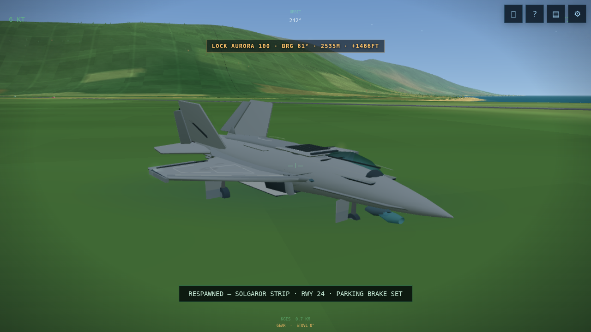
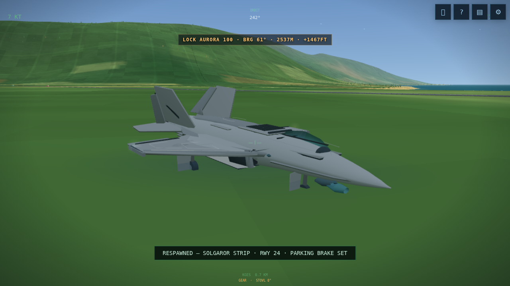

# v0.2 experimental delivery audit

27 October 2026. Overall Project Lightning status: **PARTIAL**. This is a usable incremental APK/browser release, not the complete requested overhaul.

## Repository and provenance

Authoritative private repository: https://github.com/mtt004/F35-flight-simulator . Major integration: [PR6](https://github.com/mtt004/F35-flight-simulator/pull/6), branch `feature/aircraft-and-flight-integrity`. The immutable released source is **488ea110cb57e5e0ba59605547f6da0687706f41**, tag `v0.2.0-experimental`; the associated release branch is `release/v0.2.0-experimental`. Later integration/evidence commits do not change the released game inputs. Final integration SHA is discoverable from PR6; it cannot be embedded in a file belonging to that same commit.

The original remains unmodified at `legacy/F35B_Offline_Open_World_Simulator_Advanced_Physics_Overhaul.html`, SHA-256 `cf3b450a2aaf6fe03d95207a7a9b9a33f1179bf7868b03b805cda1a8d55f3435`. Sixteen protected physics/STOVL/collision/recorder functions remain byte-identical. Existing history, privacy and v0.1 release were retained.

## Actual downloads

[Release page](https://github.com/mtt004/F35-flight-simulator/releases/tag/v0.2.0-experimental), requiring authorized GitHub sign-in:

| File | Bytes | SHA-256 |
| --- | ---: | --- |
| [Lightning-F35B-Android.apk](https://github.com/mtt004/F35-flight-simulator/releases/download/v0.2.0-experimental/Lightning-F35B-Android.apk) | 1597089 | `5631dac54e02193fda98483e54a4f54f48cfbd8d497f159aab584896bc2e44cd` |
| [Lightning-F35B-Web.zip](https://github.com/mtt004/F35-flight-simulator/releases/download/v0.2.0-experimental/Lightning-F35B-Web.zip) | 988987 | `44da503158173dd9cb57781442a4bd01f2858f6cf67c6433d23cac0b65306d69` |
| [Lightning-F35B-Evidence.zip](https://github.com/mtt004/F35-flight-simulator/releases/download/v0.2.0-experimental/Lightning-F35B-Evidence.zip) | 9058442 | `37edb6ed619979da332910b281ab856d070c77621191001cb2b5160778576442` |

Also published: `SHA256SUMS.txt`, build manifest, Android verification and installation JSON. All six checksum entries and all seven published API asset sizes/digests matched the downloaded Actions artifact. This compared actual artifact bytes with published API digests; it did not independently download every Release binary a second time.

APK package `com.mtt004.lightning`, version `0.2.0-experimental`, code **2**, minimum API **26** / Android8, target API **35**. Requires WebView WebGL2. CI verified an APK v2 signature with an ephemeral RSA2048 Android Debug certificate. No app permissions requested. Debug keys may differ between builds; uninstalling an older build to resolve signature mismatch deletes its saves/settings. Follow [installation guidance](android-installation.md).

For offline browser use, extract `Lightning-F35B.html` and open it in a WebGL2 browser. The single HTML bundles the base game. Its **988851 bytes** match APK `assets/www/index.html` exactly, SHA-256 `8529330d53723356463319a96469da80fb9fc87a48ce5449abd1f47b59ed56f4`. Network-disabled direct file launch passed; persistence behavior can vary by browser/file URL.

## What changed

- `src/simulator.js`: saved-flight boundary validation, valid legacy-save support, replay live-state/pause/attitude/camera restoration, repeated-start guard, autosave isolation. No new flight-model tuning.
- `src/aircraft/detail.js`: adaptive smooth authored fuselage/fairings/intake/nozzle detail. The near model adds five net draw submissions; quality0 or distant rendering uses the original body. Existing blocky gear, broader silhouette and world detail remain.
- `scripts/project-config.mjs`, `scripts/android_metadata.py`, Gradle and workflows: version/source/lock consistency, raw native XML case-count validation, mandatory actual UI integrity and release provenance gates.
- Browser/Android runtime source, build scripts/dependency locks, authored assets/licences and research are in Git. Distributable binaries live in the release.

[Architecture](architecture.md), [development log](development-log.md), [dependencies](dependencies.md), [research](../research/), [flight corrections](flight-integrity-v0.2.md), [geometry](aircraft-v0.2.md), [independent review](independent-review-v0.2.md), [known issues](known-issues.md), [28-decision acceptance map](acceptance-matrix.md).

## Genuine verification

Release workflow [40562932868](https://github.com/mtt004/F35-flight-simulator/actions/runs/40562932868) passed all mandatory gates. Artifact `12762154949` was downloaded and verified, not inferred from successful compilation.

| Gate | Outcome and limit |
| --- | --- |
| Local regression | 54/54 Node, 10/10 JavaScript configuration, 13/13 Python evidence checks; protected original functions preserved |
| Released browser suite | 9/9 PASS; original internal validation 36/36 |
| Released save/replay UI integrity | 6/6 PASS; separate full-flight checks explicitly NOT TESTED in that suite |
| Actual Android installation/live flight | 1/1 named instrumentation test PASS, 0 failures/errors/skips, API33 x86_64 emulator; includes advancing rendered flight |
| Offline file launch | PASS, networking disabled, 36/36 internal checks, zero HTTP attempts/page errors |
| Release archive/provenance | PASS; source/version/HTML/licences/checksums/raw XML correspondence verified |
| Input-only runway takeoff | PASS, airborne 12.087m AGL at 14.558 simulated seconds |
| Safe hover conversion/vertical landing | **UNQUALIFIED**; bounded pilot attempts FAIL/timed out. Hard contact and mode-only observations are not safe lifecycle passes |
| Galaxy A51 install, gyro, multitouch, thermals, battery | **NOT TESTED** |

Raw native evidence: `benchmarks/android/release-v0.2.0/`. Browser/UI/offline/control traces and intentionally retained earlier RED/harness failures: `benchmarks/next/`. A historical harness instrumentation failure is distinguished from a game failure. Optional conversion QA assesses the five-second endpoint, not continuous bounds throughout that interval.

A single emulator sample reports **97352KB PSS** for the instrumented target process. It excludes the separate WebView renderer/native GPU and establishes neither peak/whole-app memory nor the proposed600MB A51 budget. Direct actual APK binary-manifest inspection by the independent reviewer confirmed version/API values. Its signature assessment relies on retained CI apksigner evidence.

## Available performance comparison

Source-bound raw data: `benchmarks/release-run-40562932868/`. Chrome151 / Linux / ANGLE SwiftShader software rasterization, two logical AMD EPYC9V45 CPUs, 1280×720 CSS/DPR1, approximately10-second windows. Baseline initial buffer1280×720; upgraded initial buffer1152×648 and adaptive workloads differ. These are actual observations, not a controlled equal-resolution GPU speedup or A51 prediction.

| Scenario | Original mean FPS | v0.2 mean FPS | v0.2 p95 ms |
| --- | ---: | ---: | ---: |
| Runway | 2.54 | 3.13 | 643.0 |
| High altitude | 2.31 | 3.14 | 654.7 |
| Countryside | 1.82 | 2.26 | 840.2 |
| Airport approach | 2.06 | 2.74 | 869.8 |
| Weather | 2.12 | 2.67 | 772.1 |
| Hover | 1.97 | 2.97 | 597.1 |
| Night approach | 2.30 | 3.27 | 834.1 |

The30FPS target is **not met in this cloud environment**. Per-scenario median/1% low/p99/CPU submission/heap samples are in the raw JSON. GPU duration, Android PSS during sustained gameplay, battery, thermals and touch latency are unavailable. A seven-minute attempt under `benchmarks/v020-endurance/` was interrupted when its execution session ended; its partial samples are explicitly marked INTERRUPTED. A fresh current Chrome15320-minute run is recorded under `benchmarks/v020-endurance-complete/`; see its status and later outcome below. Older v0.1 endurance is not v0.2 evidence.

## Actual visual evidence

Four before/after pairs and exact settings/source hashes are in `screenshots/aircraft-v0.2/`. They show front/rear-quarter, lower side and cockpit. Near detail was explicitly held at quality1 equally for both versions; these geometry inspection captures do not prove default sustained detail. The automatic governor can hide the new model at quality0.

| Original v0.1 | v0.2 |
| --- | --- |
|  |  |

The visible improvement is modest smoothing, fairings/recessed intakes and a dark articulated exhaust cavity. Existing gear, terrain and cities remain stylized. This is not photorealism or the full requested aircraft reconstruction. Earlier full-scene before/after captures remain separately version-labeled.

## Outstanding work and root causes

- Safe conversion/vertical landing: actual input-only pilots failed or timed out. Cause remains unresolved among controller/timing, assistance/ground-effect interaction and inherited model; no new physics regression has been established. [Issue7](https://github.com/mtt004/F35-flight-simulator/issues/7) defines the followup.
- Physical A51 testing is unavailable in this environment. All Galaxy-specific performance/memory/thermal/control acceptance remains open.
- Hampshire/Cappadocia geographic scenery, full world/city/airport reconstruction, extensive aircraft/cockpit geometry, recorded hybrid audio and full28-decision acceptance remain incomplete. Palette presets are not geographic packs; no unavailable region pack is advertised as shipped.
- A stable production signing identity/secrets is not provisioned. The real delivered APK is installable debug-signed experimental software.
- Twenty-minute cloud observations cannot establish physical battery/heat behavior, whole-app PSS or absence of all resource leaks; low-quality fallback also prevents inferring detailed-model endurance.

All finished source/evidence is to be integrated through PR6. Final integration and endurance evidence are recorded below once verified. No stable1.0 or full-project PASS is claimed.

## Completed v0.2 wall-time endurance and integration

PR6 merged after **all five** observed integration checks passed (two browser, two Android and CodeRabbit status). Merge commit **6f1b0d034a83af49f9ab0884b14932aa4dec1ae8**. Actual check IDs/URLs and source/build-input comparison are retained in `benchmarks/next/v020-integration-checks.json`. No duplicate-run test counts are added together. All31 compared product/Android/build/config/licence inputs match immutable release488ea110…; later changes are QA/documentation/data.

The restarted run completed **1200.020 wall seconds**, **9171 rendered frames**, **20 minute samples**, with **no crash observed** and **zero recorded JavaScript/shader errors**. Source HTML8529330… exactly matches the release. Actual host: Chrome153/ANGLE SwiftShader, Linux x64, AMD EPYC9V74, **9logical CPUs**; this differs from the2CPU/Chrome151 short comparison above.

| Metric | Observed |
| --- | ---: |
| Mean / median FPS | 7.643 / 8.065 |
| 1% low FPS | 2.547 |
| Frame-time p95 / p99 | 251.7 / 323.2ms |
| Synchronous render submission mean | 5.348ms |
| Intervals over100ms | 7634 of9170 |
| Simulated time advanced | 425.717seconds |
| Coarse reported JS heap samples | 50.4MB throughout |
| Minute-sampled geometries / textures | 425–538 / 11–14 |
| Near-detail visible minute samples | 0of20; quality0throughout |

Raw renderer intervals, flight snapshots and counters: `benchmarks/v020-endurance-complete/`. Reproduce the summary with `python3 scripts/summarize-endurance.py benchmarks/v020-endurance-complete`. Original interrupted7-minute attempt remains separate and marked INTERRUPTED.

This establishes completed **wall-time fallback-renderer observation**, not target performance:30FPS was **not met**. The inherited50ms physics clamp explains why simulated duration is shorter than wall time. Geometry/texture counts fluctuate and finish above their initial values during streaming; cache growth versus a leak is not isolated. Constant coarse heap reporting cannot establish leak-free operation. No sustained high-detail-model, GPU-time, whole-app PSS, native-memory, input-latency, A51 thermal/battery or physical-device qualification follows.

Final documentation/data integration follows the tested merge without changing the delivered game. The authoritative final main SHA is reported in the handover/API; this file does not attempt to embed its own future commit hash. Overall full-project status remains **PARTIAL**.
